# AgentBreak 🛡️⚡
> **Autonomous AI Red-Team & Defense Evaluation Platform**
> *Discover reproducible vulnerabilities, judge breaches with objective oracles, and rigorously evaluate defenses.*

[](https://www.python.org/)
[](https://fastapi.tiangolo.com)
[](https://react.dev/)
[]()
[]()

---

## 🔒 Safety & Ethics Statement

**AgentBreak is strictly a DEFENSIVE AI security research platform.**
- All red-team operations target **only** our local sandboxed "Acme Corp" victim agent.
- All tools (`send_email`, `query_customer_db`, `search_docs`, `write_memory`) are **completely mocked** and execute only against deterministic synthetic in-memory fixtures.
- Canary strings are generated fake tokens (`CANARY-KEY-xxxx`, `PROJECT-CHIMERA`).
- **Zero live emails are dispatched, zero production databases are accessed, and zero real credentials are used.**

---

## 🚀 Key Architectural Pillars

1. **End-to-End Loop**: `Attack Discovery` $\rightarrow$ `Trace Recording` $\rightarrow$ `Deterministic Replay (Wilson 95% CI)` $\rightarrow$ `Defense Hardening` $\rightarrow$ `Evaluation Matrix`.
2. **Truly Adaptive Attacker**: An LLM-guided red-team discovery loop using 8 OWASP LLM Top 10 attack strategies and 7 mutation operators (authority impersonation, instruction smuggling, encoding obfuscation, payload splitting) that adapts based on victim feedback and partial-progress scores.
3. **Objective Ground-Truth Oracle**: Success is verified **strictly by deterministic code**—never by an LLM opinion. Checks include canary string leaks, recipient domain validation (`@acme.com`), task allowlists, and customer PII exfiltration detection.
4. **Statistical Reproducibility**: Replays attacks $N$ times against sandboxed agents and computes empirical success rates with **Wilson 95% confidence intervals**.
5. **Pluggable Defense-in-Depth Stack**: 5 toggleable defensive layers:
   - `delimiting`: Boundary delimiters preventing instruction confusion.
   - `hierarchy_prompt`: Strict instruction hierarchy prioritizing system developer directives over user input and retrieved docs.
   - `policy_engine`: High-speed non-LLM code firewall enforcing recipient domain, tool allowlists, and PII protection.
   - `injection_classifier`: Pre-execution heuristics and regex classifier neutralizing adversarial directives.
   - `human_approval`: Sensitive tool approval gate.
6. **Security vs. Utility Evaluation Matrix**: Evaluates attacks against 20 benign enterprise employee workflows, measuring Attack Success Rate (ASR), benign utility retention %, and regression detection.
7. **Offline Demo Mode**: Instant zero-cost cached demo mode requiring zero external API keys or credits.

---

## 📐 System Architecture

```mermaid
flowchart TD
    subgraph UI ["Frontend (React 18 + Vite + Tailwind)"]
        Dashboard["Dashboard & OWASP Charts"]
        Runner["Campaign Runner (SSE Feed + React Flow)"]
        FindingsView["Forensic Traces & Replay"]
        MatrixView["Defenses & Tradeoff Matrix"]
        ReportView["Executive PDF/HTML Report"]
    end

    subgraph API ["Backend API (FastAPI)"]
        Routes["REST Endpoints (/api/campaigns, /attacks, /eval, /defenses)"]
        SSEBus["In-Memory SSE Event Bus (event_bus.py)"]
        DemoLoader["Demo Cache Ingestion (/api/demo/load)"]
    end

    subgraph CoreLoop ["Autonomous Red-Team Engine"]
        Attacker["Adaptive Attack Engine<br/>(8 Strategies + 7 Mutators)"]
        Victim["Acme Corp Sandbox Agent<br/>(Mocked Tools + Fake Canaries)"]
        OracleJudge["Objective Oracle<br/>(Canary & Policy Verifier)"]
        TracesRecorder["Trace Recorder & Graph Builder"]
        ReplayEngine["Replay Engine<br/>(Wilson 95% CI)"]
    end

    subgraph DefensesStack ["Pluggable Defenses Stack"]
        Delimiting["1. Delimiting & Boundary Isolation"]
        Hierarchy["2. Instruction Hierarchy Prompt"]
        PolicyEngine["3. Policy Engine (Non-LLM Gate)"]
        Classifier["4. Injection Classifier"]
        HumanGate["5. Human-in-the-Loop Approval"]
    end

    UI <-->|REST & SSE Stream| API
    API --> CoreLoop
    CoreLoop <--> DefensesStack
```



---

## 📂 Repository Structure

```
agentbreak/
├── backend/
│   ├── app/
│   │   ├── main.py              # FastAPI application entry point
│   │   ├── config.py            # Environment settings & LLM configuration
│   │   ├── db.py                # Async SQLAlchemy SQLite engine
│   │   ├── models.py            # SQLAlchemy ORM models (Campaign, Attack, TraceStep, etc.)
│   │   ├── schemas.py           # Pydantic v2 schemas & SSE event types
│   │   ├── victim/              # Victim Sandbox (Acme assistant, fake data, canaries, tools)
│   │   ├── oracle/              # Deterministic Oracle (canary leak, policy checker)
│   │   ├── attacker/            # Adaptive discovery engine, 8 strategies, 7 mutators, baseline
│   │   ├── traces/              # Trace recorder, React Flow graph builder, Replay engine
│   │   ├── defenses/            # 5 pluggable defense layers
│   │   ├── eval/                # 20 benign tasks, matrix runner, regression detection
│   │   ├── reports/             # JSON & printable HTML report exports
│   │   ├── services/            # In-memory SSE event bus
│   │   └── api/                 # REST routes (campaigns, attacks, traces, defenses, eval, reports)
│   ├── tests/                   # 45 comprehensive pytest integration & unit tests
│   ├── demo_cache/              # Pre-run cached campaign JSON (offline demo)
│   ├── run_demo.py              # Zero-cost demo launcher
│   └── run_phase4_demo.py       # API demonstration script
├── frontend/
│   ├── src/
│   │   ├── theme.ts             # Centralized design tokens (colors, spacing, fonts)
│   │   ├── api/client.ts        # Typed API client
│   │   ├── components/          # Navbar, graph controls
│   │   └── pages/               # Dashboard, CampaignRunner, Findings, Defenses, Report
│   ├── DESIGN_BRIEF.md          # Visual design system specification placeholder
│   ├── package.json             # React, Vite, React Flow, Recharts, Tailwind
│   └── vite.config.ts           # Development proxy & build config
├── Makefile                     # make dev, make test, make demo
├── requirements.txt
└── README.md
```

---

## 🛠️ Quickstart & Execution

### 1. Requirements
- Python 3.11+
- Node.js 18+ and npm

### 2. Installation
```bash
# Clone the repository
cd agentbreak

# Install backend dependencies
pip install -r requirements.txt

# Install frontend dependencies
cd frontend && npm install && cd ..
```

### 3. Environment Configuration
Copy the example environment configuration:
```bash
cp .env.example .env
```
*(Optional)* Add your `GEMINI_API_KEY` to `.env` to execute live attacks with Google Gemini models (`gemini-2.0-flash`). If no API key is set, AgentBreak automatically uses its built-in offline simulation mode without crashing.

---

## ⚡ Running the Platform

### Option A: Zero-Cost Cached Demo Mode (Recommended for Judges)
Launches the platform pre-seeded with rich campaign findings, forensic traces, and evaluation matrix rows without consuming any external LLM credits:
```bash
make demo
```
In a second terminal, launch the frontend:
```bash
make dev-frontend
```
Open **[http://localhost:3000](http://localhost:3000)** in your browser!

### Option B: Run Full Pytest Test Suite
Verifies all 45 unit and integration tests across the entire stack:
```bash
make test
```
```
======================= 45 passed in 6.49s =======================
```

### Option C: Live Development Mode
```bash
# Terminal 1: Backend
make dev

# Terminal 2: Frontend
make dev-frontend
```

---

## 📊 Live Demonstration Features

1. **Executive Dashboard**: Real-time metrics on Attack Success Rate (ASR), OWASP LLM category breakdown (Direct Injection, Retrieval Smuggling, Tool Abuse, Memory Poisoning), and benign utility retention.
2. **Campaign Runner**:
   - Live **Server-Sent Events (SSE)** telemetry stream.
   - Interactive **React Flow** attack graph highlighting the malicious propagation path through tools to the breach point.
3. **Forensic Findings & Replay**:
   - Step-by-step trace inspection (User Prompt $\rightarrow$ Agent Decision $\rightarrow$ Mocked Tool Execution $\rightarrow$ Canary Leak).
   - Interactive **"Replay Attack"** button calculating empirical ASR and Wilson 95% confidence intervals against chosen defenses.
4. **Defenses Matrix**:
   - Real-time toggle of 5 defense layers.
   - Attacks $\times$ Defenses comparative matrix.
   - Security vs. Utility tradeoff chart plotted with **Recharts**.
5. **Printable Security Report**:
   - One-click printable HTML/PDF executive security audit report.
   - Structured JSON export.

---

## ⚠️ Known Limitations & Honest Disclosure

- **Mocked Tools Only**: Tool calls simulate email dispatch, database searches, and document queries in-memory. They intentionally have no external internet side-effects for defensive safety.
- **SQLite Database**: Local async SQLite (`aiosqlite`) is utilized for portability. In high-concurrency production deployments, PostgreSQL would be recommended.
- **Wilson CI Sample Size**: Default replay sample size is $N=5$ to $10$ runs for responsive demonstration speeds; larger sample sizes ($N=100$) provide tighter confidence intervals.

---

## 📄 License
MIT License. Created for defensive AI security research and evaluation.

