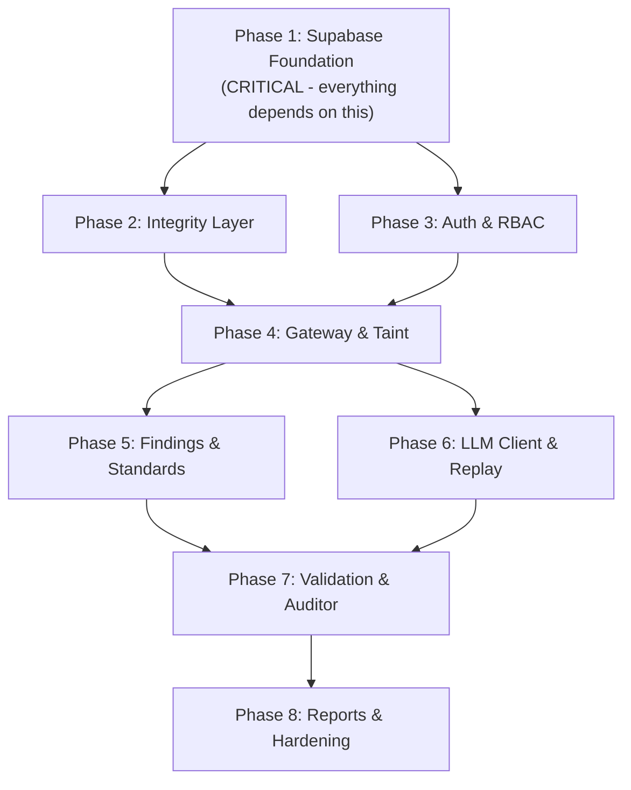

# AgentBreak: Implementation Plan Audit Report

> [!IMPORTANT]
> **Bottom line:** The current codebase implements a working **prototype-level** red-team engine (attacker, victim, oracle, defenses, eval matrix, reports). However, it is **still running on the original SQLite/in-process architecture** and has **not begun the migration to Supabase** described in the plan. Roughly **~30% of the planned backend is implemented**, with approximately **0% of the Supabase database layer** and **0% of the platform security layer** (Auth, RBAC, audit, headers) in place.

---

## Audit Methodology

Every section (D1–D8, A1–A7, B1–B14, C1–C5) of the [Implementation Plan](file:///d:/Personal_Projects/JERICHO_college_round/AgentBreak%20Backend%20and%20Supabase%20Database%20Implementation%20Plan.md) was checked against the files in [backend/app/](file:///d:/Personal_Projects/JERICHO_college_round/backend/app).

### Status Legend
| Icon | Meaning |
|------|---------|
| ✅ | Fully implemented |
| 🟡 | Partially implemented / skeleton exists |
| ❌ | Not implemented at all |

---

## PART 0: Key Decisions (D1–D8)

| Decision | Status | Current State |
|----------|--------|---------------|
| **D1** Supabase for platform, ephemeral SQLite for sandbox | ❌ | Everything runs on a single local SQLite via aiosqlite. No Supabase connection at all. |
| **D2** Private schema `ab`, no Data API exposure | ❌ | No `ab` schema. No Supabase project. |
| **D3** RLS enabled, default deny | ❌ | No RLS. No Postgres. |
| **D4** Supabase Auth replaces custom JWT | ❌ | No auth at all. No JWT verification. All endpoints are public. |
| **D5** `ab_app` least-privilege Postgres role via pooler | ❌ | Uses local aiosqlite with no roles. |
| **D6** FastAPI SSE with event persistence | 🟡 | [event_bus.py](file:///d:/Personal_Projects/JERICHO_college_round/backend/app/services/event_bus.py) has in-memory pub/sub. Events are **not persisted** to DB. No `Last-Event-ID` resume. |
| **D7** SQL migrations in `supabase/migrations/` | ❌ | No `supabase/` directory. Tables are auto-created by SQLAlchemy `create_all()`. |
| **D8** Local fallback with `supabase start` | ❌ | No Docker Compose or Supabase CLI config. |

---

## PART A: DATABASE (Supabase)

### A1. Project Setup ❌

| Requirement | Status | Notes |
|-------------|--------|-------|
| Supabase project created | ❌ | No Supabase project references anywhere |
| Schema `ab` created, revoked from anon/authenticated | ❌ | — |
| `ab_app` role with least-privilege | ❌ | — |
| Pooled connection, `statement_cache_size=0` | ❌ | Uses `sqlite+aiosqlite` in [config.py](file:///d:/Personal_Projects/JERICHO_college_round/backend/app/config.py#L56) |
| Auth: disabled public sign-up, `app_metadata.role` | ❌ | — |
| Storage: private `reports` bucket | ❌ | — |
| Extension: `pgcrypto` | ❌ | — |

### A2. Schema ❌

The plan specifies **~25 tables** across 8 groups. The current codebase has **5 SQLAlchemy models** in [models.py](file:///d:/Personal_Projects/JERICHO_college_round/backend/app/models.py):

| Planned Table | Status | Current Equivalent |
|---------------|--------|-------------------|
| `profiles` | ❌ | — |
| `targets` | ❌ | — |
| `target_versions` | ❌ | — |
| `rag_sources` | ❌ | — |
| `fixtures` | ❌ | — |
| `canaries` | ❌ | Hardcoded in [fake_data.py](file:///d:/Personal_Projects/JERICHO_college_round/backend/app/victim/fake_data.py#L14) |
| `defense_profiles` | ❌ | Hardcoded registry in [defenses/__init__.py](file:///d:/Personal_Projects/JERICHO_college_round/backend/app/defenses/__init__.py) |
| `defense_profile_versions` | ❌ | — |
| `campaigns` | 🟡 | Exists but missing: `target_version_id`, `defense_profile_version_id`, `mode`, `surfaces`, `budget` jsonb, `llm_calls_used`, `attempts_used`, `created_by`. Uses simplified flat fields. |
| `attacks` | 🟡 | Exists but missing: `beam_depth`, `parent_attack_id`, `model_assisted` bool. Has `status` instead of `verdict` enum. |
| `runs` | ❌ | No separate `runs` table. Attacks and runs are conflated. |
| `events` | ❌ | `trace_steps` exists but is **not** append-only, has no `prev_hash`/`hash`/`taint`/`parent_seq`, no integrity chain. |
| `run_seals` | ❌ | — |
| `model_calls` | ❌ | — |
| `llm_cache` | ❌ | Budget counter exists in memory; no DB-backed prompt-hash cache. |
| `findings` | ❌ | No findings table at all. Oracle returns a verdict but nothing is persisted as a finding. |
| `finding_evidence` | ❌ | — |
| `attack_corpus` | ❌ | — |
| `audit_findings` | ❌ | — |
| `benign_tasks` | ❌ | Hardcoded in [benign_tasks.py](file:///d:/Personal_Projects/JERICHO_college_round/backend/app/eval/benign_tasks.py) (Python, not DB) |
| `validation_results` | ❌ | — |
| `eval_results` | 🟡 | `eval_matrix_results` table exists with simplified schema |
| `regression_runs` | ❌ | In-memory only via [regression.py](file:///d:/Personal_Projects/JERICHO_college_round/backend/app/eval/regression.py) |
| `approvals` | ❌ | — |
| `reports` | ❌ | — |
| `audit_log` | ❌ | — |
| `owasp_llm_categories` | ❌ | — |
| `atlas_techniques` | ❌ | — |
| `root_cause_map` | ❌ | — |

**Planned enums:** `platform_role`, `surface`, `run_kind`, `campaign_status`, `verdict`, `finding_status`, `fix_verdict`, `approval_status` — **None exist.** Status values are magic strings.

### A3. Integrity Layer (Domain 10) ❌

| Requirement | Status | Notes |
|-------------|--------|-------|
| `hash = sha256(prev_hash \|\| canonical_json(event))` | ❌ | No hash chain computation anywhere |
| `events_guard()` trigger | ❌ | No Postgres triggers |
| `deny_mutation()` trigger on append-only tables | ❌ | — |
| `revoke update, delete, truncate` on append-only tables | ❌ | — |
| `run_seals` with HMAC | ❌ | No `TRACE_SEAL_KEY` in config |
| `GET /runs/{id}/verify` endpoint | ❌ | — |

### A4. Metrics as Views ❌

None of the 10 planned metric views exist:
`v_asr_by_surface`, `v_defense_block_rate`, `v_adaptive_bypass_rate`, `v_utility_retention`, `v_unauthorized_action_rate`, `v_leak_rate`, `v_trace_completeness`, `v_replay_fidelity`, `v_mean_queries_to_first_break`, `v_regression_delta`.

The `wilson_ci()` SQL function does not exist. Wilson CI is computed in Python in [replay.py](file:///d:/Personal_Projects/JERICHO_college_round/backend/app/traces/replay.py#L150).

### A5. Access Control (Domain 12) ❌

No RLS, no `ab.app_role()`, no policies, no grant management.

### A6. Seeds and Demo Data 🟡

- [demo_cache/campaign_001.json](file:///d:/Personal_Projects/JERICHO_college_round/backend/demo_cache/campaign_001.json) exists (1 file)
- No `supabase/seed.sql`
- No OWASP/ATLAS seed lookups
- Preset targets are hardcoded in Python, not DB-seeded
- No 3 demo users per role
- No 32-combo eval matrix pre-computed cache

### A7. Performance and Retention ❌

No database indexes defined (SQLAlchemy auto-creates PK indexes only). No payload size caps.

---

## PART B: BACKEND (FastAPI)

### B1. Layering 🟡

| Requirement | Status | Notes |
|-------------|--------|-------|
| `api/ -> services/ -> core engine -> db/` | 🟡 | `api/` routes exist. `services/` has only `event_bus.py`. No `db/repositories` layer. Core engine is partially in place but directly imports models, no DI. |
| Core engine imports nothing from FastAPI | 🟡 | Oracle, attacker, victim are FastAPI-free, but `traces/recorder.py` imports ORM directly |
| `security/` module (auth, redaction, rate limits, headers) | ❌ | No `security/` directory at all |

### B2. Configuration and Secrets 🟡

| Requirement | Status | Notes |
|-------------|--------|-------|
| pydantic-settings reads env vars | ✅ | [config.py](file:///d:/Personal_Projects/JERICHO_college_round/backend/app/config.py) uses `pydantic_settings` |
| `DATABASE_URL` (pooled), `DATABASE_URL_DIRECT` | ❌ | Only `database_url` for SQLite |
| `SUPABASE_URL`, `SUPABASE_JWKS_URL` | ❌ | Not in config |
| `TRACE_SEAL_KEY` | ❌ | Not in config |
| `CORS_ORIGINS` | ❌ | Hardcoded `allow_origins=["*"]` in [main.py](file:///d:/Personal_Projects/JERICHO_college_round/backend/app/main.py#L50) |
| `GLOBAL_LLM_BUDGET` | 🟡 | `request_budget` exists (500) but is an in-memory counter, not per-campaign DB-backed |
| `.env` is git-ignored with `.env.example` | ✅ | [.env.example](file:///d:/Personal_Projects/JERICHO_college_round/.env.example) exists, `.gitignore` covers `.env` |
| Startup fails if required value missing | ❌ | All config fields have defaults, nothing is required |
| Log filter redacts key patterns and canary tokens | ❌ | No log redaction |
| `MODEL_JUDGE_ASSIST` env var | ❌ | Missing from config |

### B3. Auth and Platform RBAC (Domain 12) ❌

| Requirement | Status | Notes |
|-------------|--------|-------|
| `get_principal` dependency | ❌ | No auth dependency on any route |
| `require_role(*roles)` decorator | ❌ | — |
| Profile load + disabled check | ❌ | — |
| Admin routes call Supabase Admin API | ❌ | No user management routes |
| Rate limits (slowapi) | ❌ | Not in requirements.txt, not in code |
| Security headers (`X-Content-Type-Options`, CSP) | ❌ | Only CORS middleware (wildcard) |
| Input validation `extra=forbid` | ❌ | Pydantic schemas don't set `extra="forbid"` |
| Per-user concurrent-campaign cap | ❌ | — |

### B4. LLM Client (`llm/gemini.py`) 🟡

| Requirement | Status | Notes |
|-------------|--------|-------|
| Dedicated `llm/gemini.py` module | ❌ | LLM calls are inline in [victim/agent.py](file:///d:/Personal_Projects/JERICHO_college_round/backend/app/victim/agent.py#L218) and [attacker/engine.py](file:///d:/Personal_Projects/JERICHO_college_round/backend/app/attacker/engine.py#L273) |
| Concurrency semaphore | ❌ | — |
| Exponential backoff with jitter | 🟡 | Backoff exists but no jitter |
| Prompt-hash cache against `llm_cache` table | ❌ | No DB-backed LLM cache |
| Budget accounting via atomic SQL | ❌ | In-memory `BudgetCounter` with `threading.Lock` |
| Separate model env vars per role (attacker, victim, judge-assist, fix-suggester) | 🟡 | `victim_model` and `attacker_model` exist. No `judge_assist` or `fix_suggester` |
| Every call stored in `model_calls` | ❌ | — |

### B5. Sandbox and Tool Gateway (Domains 3,4,5,6,8,9) 🟡

| Requirement | Status | Notes |
|-------------|--------|-------|
| `SandboxFactory.create(fixture_id, seed)` builds temp SQLite | ❌ | Sandbox is in-memory Python dicts in [fake_data.py](file:///d:/Personal_Projects/JERICHO_college_round/backend/app/victim/fake_data.py) — no SQLite, no fixture_id/seed, no destruction |
| Static tool registry, no forbidden imports | 🟡 | [TOOL_REGISTRY](file:///d:/Personal_Projects/JERICHO_college_round/backend/app/victim/tools.py#L134) exists. No lint rule or test scanning for `subprocess`/`os.system`/`socket` |
| Socket guard context | ❌ | — |
| `send_email` writes to outbox, oracle checks domain | 🟡 | `send_email` is mocked, oracle checks domain. No formal outbox table. |
| **Gateway** `victim/gateway.py`: `execute(call, ctx)` pipeline | ❌ | No gateway module. Defense hooks are called inline in `agent.py` |
| Event recording: `tool_proposed`, `policy_decision`, `tool_result`, `state_diff` | ❌ | Events are simplified trace steps without these typed events |
| **Taint tracking**: origin labels, `events.taint` array | ❌ | No taint tracking anywhere |
| **Human approval**: `approvals` table row, asyncio.Event with timeout | ❌ | [human_approval.py](file:///d:/Personal_Projects/JERICHO_college_round/backend/app/defenses/human_approval.py) auto-denies. No DB row, no async wait, no `POST /approvals/{id}/decide` |
| Memory provenance (`origin`, `trust` per sandbox seed) | ❌ | [memory.py](file:///d:/Personal_Projects/JERICHO_college_round/backend/app/victim/memory.py) is a simple key-value dict with no provenance |

### B6. Victim Agent Loop 🟡

| Requirement | Status | Notes |
|-------------|--------|-------|
| Max 8 steps | ✅ | `max_agent_steps=8` in [config.py](file:///d:/Personal_Projects/JERICHO_college_round/backend/app/config.py#L46) |
| Hooks: `pre_llm`, `pre_tool`, `post_retrieval` | ✅ | All three hooks called in [agent.py](file:///d:/Personal_Projects/JERICHO_college_round/backend/app/victim/agent.py#L126-L193) |
| `pre_response` output filter | ❌ | No post-response output filter |
| Memory two-session attack (poison then trigger) | ❌ | Memory is per-session but no two-session orchestration |
| Temperature 0 for victim | 🟡 | Default is `0.1`, plan says `0` |

### B7. Oracle 🟡

| Requirement | Status | Notes |
|-------------|--------|-------|
| Pure functions, no LLM | ✅ | [oracle.py](file:///d:/Personal_Projects/JERICHO_college_round/backend/app/oracle/oracle.py) is fully deterministic |
| Canary leak detection | ✅ | Full + partial match detection |
| Unauthorized action detection | 🟡 | Tool allowlist check exists. No manifest-based RBAC check. |
| Policy violation detection | ✅ | Email domain, data export checks |
| Persistence check (memory poisoning) | ❌ | — |
| Bad recipient check (outbox domain) | ✅ | Email domain check |
| `Verdict(verdict, evidence_event_seqs, partial_score)` scale (0/0.25/0.5/0.75/1.0) | 🟡 | Returns `partial_score` float but doesn't follow the specified 0/0.25/0.5/0.75/1.0 scale |
| LLM assist for ambiguous paraphrased leaks + `model_assisted` flag | ❌ | — |

### B8. Trace Recorder and Replay 🟡

| Requirement | Status | Notes |
|-------------|--------|-------|
| `Recorder.append(event)` with seq and hash | ❌ | [recorder.py](file:///d:/Personal_Projects/JERICHO_college_round/backend/app/traces/recorder.py) records steps but **no seq numbering, no hash chain** |
| Exact replay from `model_calls` | ❌ | [replay.py](file:///d:/Personal_Projects/JERICHO_college_round/backend/app/traces/replay.py) re-runs the agent live, not from recorded model calls |
| Statistical rerun N times with Wilson CI | ✅ | Wilson CI computation implemented |
| Flaky detection (1 of 5 flagged) | ❌ | — |

### B9. Attacker Engine 🟡

| Requirement | Status | Notes |
|-------------|--------|-------|
| Adaptive loop: read prior, generate, inject, oracle, feedback | ✅ | [engine.py](file:///d:/Personal_Projects/JERICHO_college_round/backend/app/attacker/engine.py) implements the full loop |
| Strategies: 8 types | ✅ | [strategies.py](file:///d:/Personal_Projects/JERICHO_college_round/backend/app/attacker/strategies.py) has registry |
| Bounded beam search (width 3, depth 4) | ❌ | Linear iteration, not beam search. No `parent_attack_id` tree. |
| **Feedback sanitizer**: strip canary values, raw records, system prompt | ❌ | Feedback is sent raw to attacker LLM in [scoring.py](file:///d:/Personal_Projects/JERICHO_college_round/backend/app/attacker/scoring.py#L36) |
| Fallback mutators | ✅ | [mutators.py](file:///d:/Personal_Projects/JERICHO_college_round/backend/app/attacker/mutators.py) exists |
| **Minimizer**: delta-debug with majority reruns | ❌ | No minimization at all |
| **Dedupe**: cluster by root cause, upsert on `root_cause_key` | ❌ | No deduplication |

### B10. Findings, Severity, Standards Mapping ❌

| Requirement | Status | Notes |
|-------------|--------|-------|
| `severity_score = impact x exploitability x reach` | ❌ | No severity computation |
| Labels Low/Medium/High/Critical (1-15/16-40/41-75/76-125) | ❌ | — |
| OWASP LLM category mapping via `root_cause_map` | ❌ | Categories are strings, not mapped to a lookup table |
| ATLAS optional mapping | ❌ | — |
| NIST AI RMF fields | ❌ | — |

### B11. Permission Auditor, Validation, Regression, Eval Matrix 🟡

| Requirement | Status | Notes |
|-------------|--------|-------|
| **Auditor** (`audit/`): static, no LLM, writes `audit_findings` | ❌ | No `audit/` module |
| **ValidationService** (check A/B/C, verdict rules) | ❌ | No formal validation service with the specified A/B/C checks |
| **RegressionService** | 🟡 | [regression.py](file:///d:/Personal_Projects/JERICHO_college_round/backend/app/eval/regression.py) has basic diff logic but not DB-backed |
| **Eval matrix** (5 factors = 32 combos) | 🟡 | [matrix.py](file:///d:/Personal_Projects/JERICHO_college_round/backend/app/eval/matrix.py) has 7 curated combos, not 32. No `combo_bits` encoding. |

### B12. Campaign Runner and SSE 🟡

| Requirement | Status | Notes |
|-------------|--------|-------|
| `CampaignService` pins target+defense versions, snapshot | 🟡 | Campaign creates with `config_snapshot` but doesn't pin immutable versions |
| Asyncio task registry for cancel | ❌ | `asyncio.create_task()` called but no registry, no cancel endpoint functional |
| Crash recovery: running → interrupted on startup | ❌ | — |
| **EventBus** with incrementing event ID | 🟡 | [event_bus.py](file:///d:/Personal_Projects/JERICHO_college_round/backend/app/services/event_bus.py) works but no incrementing IDs |
| `Last-Event-ID` replay from DB | ❌ | — |
| SSE requires auth (fetch-based, no token in URL) | ❌ | SSE is fully public |

### B13. Reports and Safe Export 🟡

| Requirement | Status | Notes |
|-------------|--------|-------|
| Jinja2 with autoescape | ❌ | HTML is built with f-strings in [export.py](file:///d:/Personal_Projects/JERICHO_college_round/backend/app/reports/export.py#L93) — **XSS vulnerability** |
| PDF rendering | ❌ | — |
| CSV formula injection prevention (`=`, `+`, `-`, `@` prefix) | ❌ | — |
| Files to private `reports` bucket | ❌ | — |
| Signed URL for download | ❌ | — |
| Every export writes `audit_log` | ❌ | — |
| Report contents: methodology, sandbox-only statement | ❌ | Partial report content |

### B14. API Contract 🟡

| Planned Route | Status | Notes |
|---------------|--------|-------|
| `GET /auth/me` | ❌ | — |
| `CRUD /users` | ❌ | — |
| `CRUD /targets`, `/targets/{id}/audit` | ❌ | — |
| `CRUD /defense-profiles` | 🟡 | [api/defenses.py](file:///d:/Personal_Projects/JERICHO_college_round/backend/app/api/defenses.py) has list/get. No CRUD with versioning. |
| `POST /campaigns`, `POST /campaigns/{id}/cancel` | 🟡 | Create exists in [api/campaigns.py](file:///d:/Personal_Projects/JERICHO_college_round/backend/app/api/campaigns.py). No cancel. |
| `GET /campaigns/{id}`, `/stream` | 🟡 | Get exists. SSE stream exists in [api/stream.py](file:///d:/Personal_Projects/JERICHO_college_round/backend/app/api/stream.py). |
| `GET /runs/{id}`, `/events`, `/verify` | ❌ | No runs routes |
| `POST /runs/{id}/replay` | 🟡 | Replay exists but keyed by attack_id not run_id |
| `GET /findings`, `/findings/{id}` | ❌ | — |
| `POST /findings/{id}/rerun?n=5` | ❌ | — |
| `POST /defense/validate`, `POST /regression/run`, `GET /compare` | ❌ | — |
| `GET /approvals`, `POST /approvals/{id}/decide` | ❌ | — |
| `GET /metrics/summary`, `GET /standards/mapping` | 🟡 | [api/metrics.py](file:///d:/Personal_Projects/JERICHO_college_round/backend/app/api/metrics.py) exists with basic summary. No standards mapping. |
| `POST /reports/export` | 🟡 | [api/reports.py](file:///d:/Personal_Projects/JERICHO_college_round/backend/app/api/reports.py) exists |
| `GET /audit-log` | ❌ | — |
| `GET /health` | ✅ | Exists in [main.py](file:///d:/Personal_Projects/JERICHO_college_round/backend/app/main.py#L68). Leaks internal details (models, demo_mode). |
| Route prefix `/api/v1` | ❌ | Routes use `/api/` without `v1` |

---

## PART C: INTEGRATION AND DELIVERY

### C1. Build Phases Status

| Phase | Status | Assessment |
|-------|--------|------------|
| **1 Foundation** (Supabase, schema, migrations, seeds, settings) | ❌ | Nothing started |
| **2 Integrity** (hash chain, triggers, seals, verify) | ❌ | Nothing started |
| **3 World** (sandbox factory, tools, canaries, gateway, victim) | 🟡 | Tools and victim loop exist. No sandbox factory, no gateway, no canary table. |
| **4 Judging** (oracle, recorder, exact replay) | 🟡 | Oracle exists. Recorder exists but no hash chain. No exact replay (model_calls). |
| **5 Attack** (LLM client, attacker, sanitizer, mutators, minimizer, dedupe) | 🟡 | Attacker and mutators exist. No sanitizer, no minimizer, no dedupe. |
| **6 Defense** (control pipeline, approvals, validation A/B/C, regression, eval) | 🟡 | 5 defense controls exist. No proper approvals, no validation A/B/C, regression is basic. |
| **7 Platform** (Auth, RBAC, REST, EventBus, SSE, metrics, reports) | 🟡 | Routes and SSE exist. No Auth, no RBAC, no proper metrics views. |
| **8 Hardening** (RLS tests, rate limits, headers, redaction, demo_cache) | ❌ | Nothing started |

### C2. Cross-Cutting Rules

| Requirement | Status |
|-------------|--------|
| Real API keys only in server env | ✅ |
| Canary tokens never in logs/SSE/feedback | ❌ No log redaction, no feedback sanitizer |
| Attacker only receives sanitized feedback | ❌ |
| Pinned dependency versions | ❌ Version ranges, not pins |
| `pip-audit` run | ❌ |

### C3. Test and Verification Checklist

| Test Type | Status | Notes |
|-----------|--------|-------|
| Pure unit tests (oracle per verdict, policy, hash chain, Wilson, severity, sanitizer) | 🟡 | [test_oracle.py](file:///d:/Personal_Projects/JERICHO_college_round/backend/tests/test_oracle.py), [test_policy_engine.py](file:///d:/Personal_Projects/JERICHO_college_round/backend/tests/test_policy_engine.py) exist. No hash chain, severity, sanitizer tests. |
| Isolation test (scan victim/ for forbidden imports, socket guard) | ❌ | — |
| DB tests (chain trigger, append-only, viewer token) | ❌ | — |
| API tests (route x role matrix, disabled user, 429) | 🟡 | [test_api.py](file:///d:/Personal_Projects/JERICHO_college_round/backend/tests/test_api.py) exists but doesn't test auth/roles |
| Replay determinism test | 🟡 | [test_replay.py](file:///d:/Personal_Projects/JERICHO_college_round/backend/tests/test_replay.py) exists but tests live rerun, not exact replay |
| Utility guard (deny-all = fixed-with-regression) | ❌ | — |
| XSS test (script tags render as text) | ❌ | HTML report uses f-strings, is **vulnerable** |
| Clean restart (`docker compose up`) | ❌ | No Docker Compose |

---

## Summary: Gap Inventory

### 🔴 Critical Gaps (Must-have for plan compliance)

1. **Supabase migration** — The entire database layer needs to be rebuilt: Postgres schema `ab`, ~25 tables, enums, RLS, triggers, roles, migrations
2. **Authentication & RBAC** — Zero auth. All routes are public. Need Supabase Auth integration, `get_principal`, `require_role`
3. **Hash-chain integrity** — No event integrity. Need `prev_hash`/`hash` on events, `run_seals`, HMAC, verify endpoint
4. **Gateway module** — Tool execution pipeline (`victim/gateway.py`) is missing. Taint tracking doesn't exist.
5. **Findings system** — No `findings` table or logic. Oracle verdicts are not persisted as findings.
6. **Feedback sanitizer** — Attacker LLM can see raw canary values and system prompt text in feedback
7. **XSS in reports** — HTML report uses f-strings with unsanitized attack payloads → XSS vector

### 🟡 Important Gaps (Needed for full functionality)

8. **LLM client module** (`llm/gemini.py`) — Centralized with semaphore, jitter, DB cache, per-campaign atomic budget
9. **Sandbox factory** — Should be temp SQLite per run with fixture seed, not Python dicts
10. **Exact replay** — Need `model_calls` storage and playback engine
11. **Minimizer** — Delta-debug for exploit minimization
12. **Dedupe** — Cluster findings by root cause
13. **Permission auditor** (`audit/`) — Static analysis of tools vs manifest
14. **Validation service** (check A/B/C) with verdict rules
15. **Metrics views** — 10 SQL views with Wilson CI
16. **Security headers** — CSP, X-Content-Type-Options, CORS origin allowlist
17. **Rate limiting** — slowapi on critical endpoints
18. **Approvals** — DB-backed with asyncio.Event + timeout + API endpoint
19. **Audit log** — Append-only governance table
20. **Standards mapping** — OWASP/ATLAS/NIST seed tables and API endpoint

### 🟢 Minor Gaps (Polish)

21. API versioning (`/api/v1`)
22. Input validation `extra=forbid`
23. Log redaction filter
24. Crash recovery (running → interrupted)
25. `Last-Event-ID` SSE resume
26. Demo cache with 32-combo matrix
27. Docker Compose / `supabase start` local fallback
28. Pinned dependencies + `pip-audit`

---

## Detailed Implementation Plan

> [!TIP]
> The phases below follow the dependency order from the plan (C1) but are adapted to the current codebase state. Each phase lists **concrete files to create or modify** and **acceptance criteria**.

### Phase 1: Foundation (Database Migration) — ~3-4 days

**Goal:** Replace SQLite with Supabase Postgres. All 25+ tables exist, seeds run, connection works.

| Task | Files | Acceptance |
|------|-------|------------|
| 1.1 Create Supabase project, note URL/keys | Dashboard | Project exists |
| 1.2 Create `supabase/migrations/001_schema.sql` | `supabase/migrations/001_schema.sql` | Schema `ab`, all enums, all 25+ tables with correct columns/constraints |
| 1.3 Create `ab_app` role with least-privilege grants | `supabase/migrations/002_roles.sql` | Role exists, has only needed privileges |
| 1.4 Enable RLS on all tables, default deny | `supabase/migrations/003_rls.sql` | Direct `anon`/`authenticated` access blocked |
| 1.5 Update [config.py](file:///d:/Personal_Projects/JERICHO_college_round/backend/app/config.py) | `backend/app/config.py` | Add `SUPABASE_URL`, `SUPABASE_JWKS_URL`, `DATABASE_URL` (pooled), `DATABASE_URL_DIRECT`, `TRACE_SEAL_KEY`, `CORS_ORIGINS`, `GLOBAL_LLM_BUDGET`, `MODEL_JUDGE_ASSIST` |
| 1.6 Update [.env.example](file:///d:/Personal_Projects/JERICHO_college_round/.env.example) | `.env.example` | All new env vars documented |
| 1.7 Update [db.py](file:///d:/Personal_Projects/JERICHO_college_round/backend/app/db.py) | `backend/app/db.py` | asyncpg engine with `statement_cache_size=0`, pooled connection. Keep aiosqlite fallback for sandbox. |
| 1.8 Rewrite [models.py](file:///d:/Personal_Projects/JERICHO_college_round/backend/app/models.py) | `backend/app/models.py` | SQLAlchemy models mirror all migration tables. UUID PKs, timestamptz, jsonb, schema='ab'. |
| 1.9 Create `supabase/seed.sql` + Python seeder | `supabase/seed.sql`, `backend/seed.py` | OWASP/ATLAS lookups, 2 preset targets, fixture seed, 20 benign tasks, 3 demo users, default defense profiles |
| 1.10 Create Storage bucket `reports` (private) | Dashboard | Bucket exists, no public access |
| 1.11 Add `requirements.txt` entries | `requirements.txt` | `asyncpg`, `supabase` (admin), `slowapi`, `jinja2`, `weasyprint` or `pdfkit` |

### Phase 2: Integrity Layer — ~1-2 days

**Goal:** Hash-chained events, append-only enforcement, run seals, verify endpoint.

| Task | Files | Acceptance |
|------|-------|------------|
| 2.1 Create `events_guard()` and `deny_mutation()` triggers | `supabase/migrations/004_integrity.sql` | Inserting an event with wrong seq or prev_hash fails; UPDATE/DELETE on events/run_seals/audit_log fails |
| 2.2 Build hash chain computation in Python | `backend/app/traces/hash_chain.py` | `compute_hash(prev_hash, event)` returns sha256 |
| 2.3 Update [recorder.py](file:///d:/Personal_Projects/JERICHO_college_round/backend/app/traces/recorder.py) | `backend/app/traces/recorder.py` | Recorder computes seq + hash per event, batch inserts, writes `run_seals` with HMAC at run end |
| 2.4 Create `GET /api/v1/runs/{id}/verify` | `backend/app/api/runs.py` | Recomputes chain from events, compares with seal, returns ok or first broken seq |

### Phase 3: Auth & Platform Security — ~2-3 days

**Goal:** All endpoints require authentication. RBAC enforced. Security headers. Rate limits.

| Task | Files | Acceptance |
|------|-------|------------|
| 3.1 Create `backend/app/security/` module | `backend/app/security/__init__.py`, `auth.py`, `rbac.py`, `headers.py`, `redaction.py` | Module exists |
| 3.2 Implement `get_principal` dependency | `backend/app/security/auth.py` | Verifies Supabase JWT, extracts sub + role, loads profile, rejects disabled users |
| 3.3 Implement `require_role(*roles)` | `backend/app/security/rbac.py` | Decorator/dependency that checks principal role against allowed roles |
| 3.4 Add security headers middleware | `backend/app/security/headers.py` | `X-Content-Type-Options: nosniff`, CSP, no wildcard CORS |
| 3.5 Add rate limiting (slowapi) | `backend/app/security/rate_limit.py` | Strict on `/campaigns`, `/findings/*/rerun`, `/defense/validate`, `/reports/export` |
| 3.6 Add log redaction filter | `backend/app/security/redaction.py` | Canary tokens and key patterns redacted from logs |
| 3.7 Update all Pydantic schemas with `extra="forbid"` | `backend/app/schemas.py` | Extra fields rejected |
| 3.8 Update [main.py](file:///d:/Personal_Projects/JERICHO_college_round/backend/app/main.py) | `backend/app/main.py` | CORS from `CORS_ORIGINS` config, security headers middleware, rate limiter |
| 3.9 Wire auth to all API routes | All `backend/app/api/*.py` | Every route uses `get_principal` + `require_role` |
| 3.10 Create audit_log writing utility | `backend/app/security/audit.py` | Helper function that inserts into `ab.audit_log` |
| 3.11 Create `CRUD /users` routes | `backend/app/api/users.py` | Admin-only, via Supabase Admin API, writes audit_log |

### Phase 4: Gateway & Taint — ~2 days

**Goal:** Centralized tool execution with policy pipeline, taint tracking, and proper event recording.

| Task | Files | Acceptance |
|------|-------|------------|
| 4.1 Create `victim/gateway.py` | `backend/app/victim/gateway.py` | `execute(call, ctx)` → validate → policy.decide() → allow/deny/pending_approval → execute → record events |
| 4.2 Implement taint tracking | `backend/app/victim/taint.py` | Origin labels (user, trusted, untrusted_retrieval, memory), propagation to events |
| 4.3 Refactor [agent.py](file:///d:/Personal_Projects/JERICHO_college_round/backend/app/victim/agent.py) to use gateway | `backend/app/victim/agent.py` | All tool calls go through gateway, `pre_response` output filter added |
| 4.4 Create `SandboxFactory` | `backend/app/victim/sandbox.py` | `create(fixture_id, seed)` → temp SQLite with seeded data, destroyed in `finally` |
| 4.5 Update memory with provenance | `backend/app/victim/memory.py` | `origin`, `trust` fields on entries |

### Phase 5: Findings, Severity & Standards — ~2 days

**Goal:** Oracle verdicts produce persisted findings with severity scores and standards mapping.

| Task | Files | Acceptance |
|------|-------|------------|
| 5.1 Create findings service | `backend/app/services/findings.py` | Creates/upserts findings from oracle verdicts. Computes `severity_score`, label, `root_cause_key` dedupe. |
| 5.2 Create standards mapping | `backend/app/services/standards.py` | Maps findings to OWASP LLM categories and optionally ATLAS via `root_cause_map` |
| 5.3 Create findings API routes | `backend/app/api/findings.py` | `GET /findings`, `GET /findings/{id}`, `POST /findings/{id}/rerun?n=5` |
| 5.4 Create feedback sanitizer | `backend/app/attacker/sanitizer.py` | Strips canary values, raw records, system prompt text before returning to attacker |
| 5.5 Create minimizer | `backend/app/attacker/minimizer.py` | Delta-debug turns and sentences, accepts reduction only if oracle still returns success in majority of 3 reruns |

### Phase 6: LLM Client & Exact Replay — ~1-2 days

**Goal:** Centralized LLM client with caching and exact replay capability.

| Task | Files | Acceptance |
|------|-------|------------|
| 6.1 Create `llm/gemini.py` | `backend/app/llm/gemini.py` | Wraps google-genai with: concurrency semaphore, exponential backoff with jitter, prompt-hash cache, atomic budget SQL, role separation |
| 6.2 Store all calls in `model_calls` | Via LLM client | Every call persisted with prompt_hash, prompt, response, model, temperature, from_cache |
| 6.3 Create exact replay engine | `backend/app/traces/exact_replay.py` | Implements LLM interface but returns recorded `model_calls`. Compares tool-call sequence and final state_diff hash. |
| 6.4 Refactor agent.py and engine.py to use LLM client | `backend/app/victim/agent.py`, `backend/app/attacker/engine.py` | Both use the centralized client |

### Phase 7: Validation, Auditor & Eval Completion — ~2 days

**Goal:** Full validation A/B/C, permission auditor, regression service, 32-combo eval matrix.

| Task | Files | Acceptance |
|------|-------|------------|
| 7.1 Create Permission Auditor | `backend/app/audit/auditor.py` | Static analysis: for each tool and role, compare accepted arguments with manifest. Write `audit_findings`. |
| 7.2 Create ValidationService | `backend/app/services/validation.py` | Check A (replay/live rerun), Check B (adaptive re-attack), Check C (benign suite). Verdict: fixed/partially_mitigated/not_fixed/fixed_with_regression. |
| 7.3 Expand eval matrix to 32 combos | `backend/app/eval/matrix.py` | 5 factors × 2^5 = 32 combos with `combo_bits` |
| 7.4 Create validation + regression API routes | `backend/app/api/validation.py` | `POST /defense/validate`, `POST /regression/run`, `GET /compare?a=&b=` |
| 7.5 Create approval routes | `backend/app/api/approvals.py` | `GET /approvals`, `POST /approvals/{id}/decide` |

### Phase 8: Reports, Metrics Views & Hardening — ~2 days

**Goal:** Secure reports, SQL metrics views, full test suite, deployment readiness.

| Task | Files | Acceptance |
|------|-------|------------|
| 8.1 Rewrite report export with Jinja2 + autoescape | `backend/app/reports/export.py`, `backend/app/reports/templates/` | Attack payloads rendered as text, not HTML |
| 8.2 Add PDF generation | `backend/app/reports/export.py` | Server-side HTML-to-PDF |
| 8.3 Add CSV formula injection prevention | `backend/app/reports/export.py` | Cells starting with `=+\-@` are prefixed |
| 8.4 Create 10 SQL metric views | `supabase/migrations/005_views.sql` | All views with `wilson_ci()` function |
| 8.5 Create `GET /metrics/summary` and `GET /standards/mapping` | `backend/app/api/metrics.py` | Returns num/den/CI for all metrics |
| 8.6 Create demo_cache with 32-combo matrix | `backend/demo_cache/` | Pre-computed JSON for `DEMO_MODE` |
| 8.7 Create Docker Compose | `docker-compose.yml` | `docker compose up` starts API + local Supabase |
| 8.8 Pin dependencies + run pip-audit | `requirements.txt` | Exact versions, no known vulnerabilities |
| 8.9 Write missing tests (C3 checklist) | `backend/tests/` | All 8 test categories from C3 |
| 8.10 Health endpoint cleanup | `backend/app/main.py` | Remove internal detail (model names, demo_mode) |

---

## Priority Execution Order

For a hackathon context, if time is limited, implement in this order:

> [!WARNING]
> **Phase 1 (Supabase Foundation) is the critical blocker.** Nothing else in the plan can be implemented correctly without the Postgres schema in place. The current SQLite setup fundamentally conflicts with the architecture described in the plan.

> [!NOTE]
> **Estimated total effort:** ~15-20 days for a single developer, or ~7-10 days with 2 developers working in parallel (Track 1: Phases 1–4, Track 2: Phase 3 auth skeleton + Phase 5–6 can be stubbed against interfaces).
