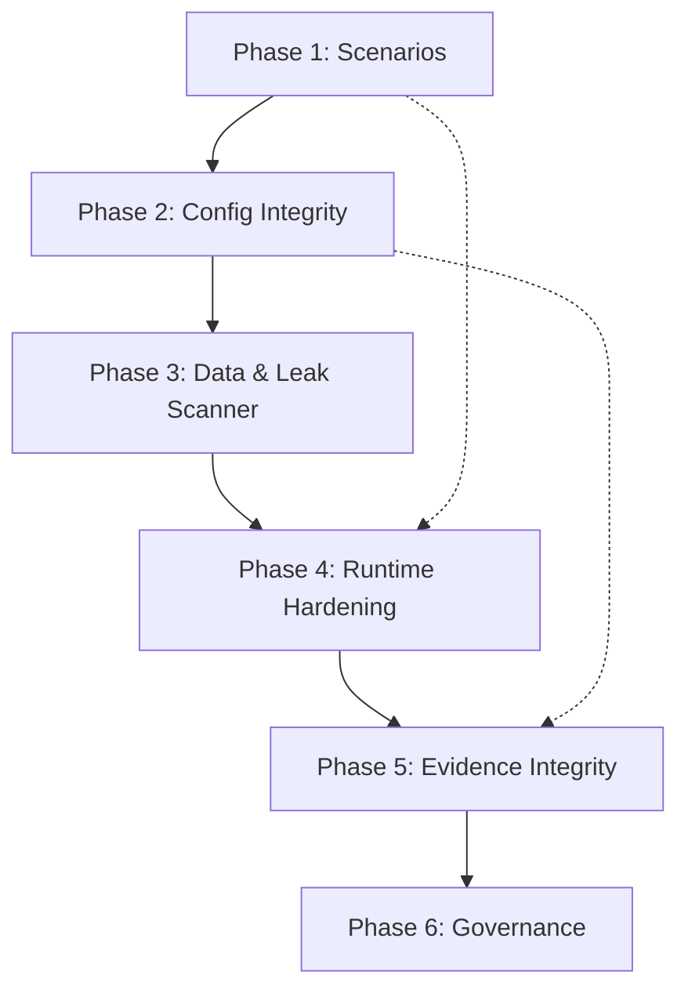

# AgentBreak Security Implementation Plan

> Based on [AgentBreak_Final_Security_Implementation_Report (1).md](file:///d:/Personal_Projects/JERICHO_college_round/AgentBreak_Final_Security_Implementation_Report%20(1).md)
> Mapping all 37 controls against the existing codebase.

---

## Audit Summary: What Exists vs What's Missing

### ✅ Controls Already Implemented (Partial or Full)

| Control | Status | Existing File(s) | Gap |
|---------|--------|-------------------|-----|
| GOV-04 | ✅ Partial | [policy.py](file:///d:/Personal_Projects/JERICHO_college_round/backend/app/victim/policy.py) | Policy rules exist but no versioning or runtime hash |
| GOV-05 | ✅ Partial | [human_approval.py](file:///d:/Personal_Projects/JERICHO_college_round/backend/app/defenses/human_approval.py) | Approval gate exists but no UI queue or audit trail |
| ID-02 | ✅ Partial | [rbac.py](file:///d:/Personal_Projects/JERICHO_college_round/backend/app/security/rbac.py), [auth.py](file:///d:/Personal_Projects/JERICHO_college_round/backend/app/security/auth.py) | RBAC framework exists, but Principal is mocked |
| IN-01 | ✅ Partial | [injection_classifier.py](file:///d:/Personal_Projects/JERICHO_college_round/backend/app/defenses/injection_classifier.py) | LLM-based classifier exists, no rule-based fallback |
| IN-02 | ✅ Partial | [policy_engine.py](file:///d:/Personal_Projects/JERICHO_college_round/backend/app/defenses/policy_engine.py) | Validates tool args but no structured output schema validation |
| IN-03 | ✅ Partial | [taint.py](file:///d:/Personal_Projects/JERICHO_college_round/backend/app/victim/taint.py), [delimiting.py](file:///d:/Personal_Projects/JERICHO_college_round/backend/app/defenses/delimiting.py) | Taint tracker exists but doesn't tag RAG/email/tool-output provenance labels |
| DATA-01 | ✅ Partial | [fake_data.py](file:///d:/Personal_Projects/JERICHO_college_round/backend/app/victim/fake_data.py) | Synthetic data exists but no data classification labels or access-scope enforcement |
| DATA-02 | ✅ Partial | [redaction.py](file:///d:/Personal_Projects/JERICHO_college_round/backend/app/security/redaction.py), canary checks | Log redaction exists, canary checks in policy_engine, but no systematic cross-channel leak scanner |
| DATA-03 | ✅ Partial | [memory.py](file:///d:/Personal_Projects/JERICHO_college_round/backend/app/victim/memory.py) | Isolated per-session memory exists but no provenance stamps or write-audit |
| TOOL-01 | ✅ Partial | [policy.py ALLOWED_TOOLS](file:///d:/Personal_Projects/JERICHO_college_round/backend/app/victim/policy.py#L123-L130) | Allowlist exists but no destination allowlist or risk-tier metadata |
| TOOL-02 | ✅ Partial | [gateway.py](file:///d:/Personal_Projects/JERICHO_college_round/backend/app/victim/gateway.py) | Gateway broker exists; logs decisions but doesn't record approval state |
| TOOL-03 | ✅ Partial | [rate_limit.py](file:///d:/Personal_Projects/JERICHO_college_round/backend/app/security/rate_limit.py) | API rate limiting exists but no per-tool schema validation layer |
| LOG-01 | ✅ Partial | [recorder.py](file:///d:/Personal_Projects/JERICHO_college_round/backend/app/traces/recorder.py) | Full trace recorder with hash chaining exists; missing policy-version and config-version fields |
| LOG-03 | ✅ Partial | [hash_chain.py](file:///d:/Personal_Projects/JERICHO_college_round/backend/app/traces/hash_chain.py) | SHA256 hash chain + HMAC seal exists; no separate protected checkpoint storage |
| RUN-01 | ✅ Partial | [config.py](file:///d:/Personal_Projects/JERICHO_college_round/backend/app/config.py) | Budget counter + max_agent_steps exist; no per-tool call-count limit or simulated-spend tracking |
| RUN-02 | ✅ Stub | [sandbox.py](file:///d:/Personal_Projects/JERICHO_college_round/backend/app/victim/sandbox.py) | Context manager stub only; no real stop control or evidence-preserve-on-kill |
| TOOL-04 | ✅ Stub | [sandbox.py](file:///d:/Personal_Projects/JERICHO_college_round/backend/app/victim/sandbox.py) | Placeholder; no real sandboxing |
| TEST-02 | ✅ Partial | Attacker engine exists | Scenarios run but no structured scenario catalogue with IDs |

### ❌ Controls Not Yet Implemented

| Control | Domain | What's Needed |
|---------|--------|---------------|
| TEST-01 | Testing | Formal threat-model catalogue with scenario IDs, preconditions, pass/fail rules |
| TEST-03 | Testing | Acceptance criteria definition and evidence retention per test |
| MODEL-02 | Model & Supply Chain | Versioned policy/prompt/config hash, frozen at run start |
| GOV-01 | Governance | Owner registry for agents, models, tools |
| GOV-02 | Governance | Component inventory (models, tools, MCP servers, deps) |
| GOV-03 | Governance | Documented risk assessment template |
| GOV-06 | Governance | Release gates / change-management checks |
| ID-01 | Identity | Unique agent and workload identity |
| ID-03 | Identity | Secrets management (no hardcoded keys in prompts/logs) |
| ID-04 | Identity | Delegation / agent-to-agent trust controls |
| INC-01 | Incident Response | Event-driven stop/revoke/preserve workflow |
| INC-02 | Incident Response | Severity classification and escalation process |
| MODEL-01 | Model & Supply Chain | Provider/dependency pre-use assessment |
| MODEL-03 | Model & Supply Chain | Model robustness evaluation suite |
| LOG-02 | Monitoring | Anomaly detection and local alert rules |
| RUN-03 | Runtime | Environment separation documentation |
| SUP-01 | Supplier | Provider data residency/retention assessment |
| SUP-02 | Supplier | Control-to-evidence traceability register |
| TOOL-05 | Tool & API | Transaction limits, dry-run mode, rollback for destructive actions |

---

## Implementation Plan — 6 Phases

> [!IMPORTANT]
> Each phase is designed to be non-breaking. New modules are additive. Existing signatures are only extended with optional parameters.

---

### Phase 1: Scenario Catalogue & Test Infrastructure (TEST-01, TEST-02, TEST-03)

**Goal:** Formalize the scenario catalogue so every attack has an ID, preconditions, pass/fail rule, framework mapping, and evidence retention.

**Files to create/modify:**

| Action | File | What |
|--------|------|------|
| **Create** | `backend/app/scenarios/catalogue.py` | `ScenarioDefinition` dataclass with: `id`, `name`, `objective`, `preconditions`, `permitted_environment`, `expected_boundary`, `pass_fail_rule`, `framework_mapping` (OWASP + ATLAS), `version`, `owner` |
| **Create** | `backend/app/scenarios/__init__.py` | Module init |
| **Create** | `backend/app/scenarios/builtin.py` | 8 built-in scenarios from §7 of the report (prompt injection, broken auth, unsafe tool action, memory poisoning, tool-output injection, unbounded consumption, evidence tampering, regression) |
| **Modify** | `backend/app/traces/recorder.py` | Add `scenario_id`, `config_version`, `policy_version` fields to the trace header |
| **Create** | `backend/app/scenarios/acceptance.py` | `AcceptanceCriteria` — the 6 first-demo criteria from §9.1 as executable checks |
| **Modify** | `backend/app/services/findings.py` | Tag each finding with `scenario_id` and `framework_mapping` |
| **Create** | `frontend/src/pages/Scenarios.tsx` | Read-only scenario catalogue browser |
| **Modify** | `frontend/src/components/Navbar.tsx` | Add "Scenarios" tab |
| **Modify** | `frontend/src/App.tsx` | Route to Scenarios page |
| **Modify** | `frontend/src/api/client.ts` | Add `fetchScenarios()` API call |

---

### Phase 2: Configuration Integrity & Versioning (MODEL-02, GOV-04 hardening, GOV-02)

**Goal:** Every run captures a frozen, hashed snapshot of the policy, prompt, model config, and defense pipeline so results are reproducible.

**Files to create/modify:**

| Action | File | What |
|--------|------|------|
| **Create** | `backend/app/security/config_integrity.py` | `ConfigSnapshot` dataclass: computes SHA256 of `{system_prompt, policy_rules, allowed_tools, defense_ids, model_name, temperature}` at run start. Returns a `config_version` hash string |
| **Modify** | `backend/app/victim/agent.py` | Capture `ConfigSnapshot` at session start; pass `config_version` to `TraceRecorder` |
| **Modify** | `backend/app/traces/recorder.py` | Store `config_version` and `policy_version` in the trace header and Event payload |
| **Create** | `backend/app/inventory.py` | `ComponentInventory` — static registry of all models, tools, defenses, dependencies with versions (GOV-02) |
| **Create** | `backend/app/api/inventory.py` | GET `/api/inventory` endpoint returning the component manifest |
| **Create** | `frontend/src/pages/Inventory.tsx` | Component inventory viewer (models, tools, defenses, deps) |

---

### Phase 3: Data Classification & Canary Leak Scanner (DATA-01, DATA-02, DATA-03 hardening)

**Goal:** Classify all synthetic data, enforce access scopes, and systematically detect canary leaks across all output channels.

**Files to create/modify:**

| Action | File | What |
|--------|------|------|
| **Modify** | `backend/app/victim/fake_data.py` | Add `classification` label ("public", "internal", "confidential", "restricted") to every data record and canary |
| **Create** | `backend/app/security/leak_scanner.py` | `LeakScanner` class: scans agent output text, tool args, tool results, memory writes, and log entries for canary tokens. Returns `LeakReport` with `{leaked: bool, channel, canary_id, snippet}` |
| **Modify** | `backend/app/victim/gateway.py` | Run `LeakScanner` on every tool result before returning to the agent |
| **Modify** | `backend/app/victim/memory.py` | Add `provenance` (origin label) and `written_at` timestamp to every memory write; reject writes containing canaries |
| **Modify** | `backend/app/traces/recorder.py` | Record leak-scan result as a trace event when a leak is detected |

---

### Phase 4: Runtime Hardening & Stop Control (RUN-01 hardening, RUN-02, TOOL-04, TOOL-05, INC-01)

**Goal:** Enforce per-tool call limits, simulated spend tracking, a real kill switch, and transaction safeguards.

**Files to create/modify:**

| Action | File | What |
|--------|------|------|
| **Create** | `backend/app/security/runtime_limits.py` | `RuntimeLimiter` class: tracks per-tool call counts, total duration, simulated spend. Raises `RuntimeLimitExceeded` when any threshold is breached |
| **Modify** | `backend/app/victim/gateway.py` | Integrate `RuntimeLimiter`; increment counters on each tool execution |
| **Modify** | `backend/app/victim/agent.py` | On `RuntimeLimitExceeded` or external kill signal: preserve evidence, seal trace, return partial result |
| **Modify** | `backend/app/victim/sandbox.py` | Implement real ephemeral SQLite provisioning with restricted filesystem scope |
| **Create** | `backend/app/security/kill_switch.py` | `KillSwitch` singleton: async event that can be set from the API to abort a running agent session |
| **Create** | `backend/app/api/killswitch.py` | POST `/api/campaigns/{id}/kill` endpoint |
| **Create** | `backend/app/security/transaction_guard.py` | `TransactionGuard`: dry-run mode for destructive tools, simulated rollback, confirmation requirement (TOOL-05) |
| **Modify** | `frontend/src/pages/CampaignRunner.tsx` | Add "Kill" / "Emergency Stop" button |

---

### Phase 5: Evidence Integrity & Anomaly Detection (LOG-01 hardening, LOG-02, LOG-03 hardening)

**Goal:** Add protected checkpoint storage, tamper-detection verification endpoint, and simple local anomaly alerts.

**Files to create/modify:**

| Action | File | What |
|--------|------|------|
| **Create** | `backend/app/traces/checkpoint.py` | `CheckpointStore`: writes sealed run manifests to a separate write-protected location; provides `verify_checkpoint()` that re-hashes the event chain and compares against the stored HMAC |
| **Create** | `backend/app/api/integrity.py` | GET `/api/integrity/{run_id}` — verifies the hash chain and seal for a given run, returns `{valid: bool, details}` |
| **Create** | `backend/app/security/anomaly_detector.py` | `AnomalyDetector`: simple rule-based alerts for: (a) >N tool calls in a run, (b) tool-call to the same tool >M times, (c) canary leak detected, (d) policy denial rate >50%. Emits alert events to the `CampaignEventBus` |
| **Modify** | `backend/app/victim/gateway.py` | Feed tool-call events to `AnomalyDetector` |
| **Modify** | `backend/app/traces/recorder.py` | On `save_to_db`, also write a protected checkpoint |
| **Create** | `frontend/src/pages/Integrity.tsx` | Evidence integrity verification UI — input a run ID, see hash chain validity |

---

### Phase 6: Governance, Identity & Compliance Metadata (GOV-01/03/06, ID-01/03, SUP-01/02, RUN-03, MODEL-01/03, INC-02, ID-04)

**Goal:** Add governance documentation, secrets hygiene, environment boundary docs, and compliance traceability. These are primarily metadata and documentation controls.

**Files to create/modify:**

| Action | File | What |
|--------|------|------|
| **Create** | `backend/app/governance/owner_registry.py` | `OwnerRegistry`: maps agent_id, model_id, tool_id to an owner name/role (GOV-01) |
| **Create** | `backend/app/governance/risk_assessment.py` | `RiskAssessment` template dataclass with fields for threat, likelihood, impact, mitigations, residual risk (GOV-03) |
| **Create** | `backend/app/governance/__init__.py` | Module init |
| **Create** | `backend/app/governance/release_gate.py` | `ReleaseGate`: checks that all P0 acceptance criteria pass before a campaign can be marked "released" (GOV-06) |
| **Modify** | `backend/app/security/auth.py` | Add `agent_identity` field to Principal; ensure each agent run gets a unique workload ID (ID-01) |
| **Create** | `backend/app/security/secrets_audit.py` | `SecretsAuditor`: scans system prompt, memory, and log output for hardcoded API keys/tokens; flags violations (ID-03) |
| **Create** | `backend/app/governance/compliance_register.py` | `ComplianceRegister`: maps each control ID to its evidence artifact location, test result, and framework crosswalk (SUP-02) |
| **Create** | `backend/app/governance/environment_boundary.py` | `EnvironmentBoundary`: documents what is mock vs real, what network access exists, isolation guarantees (RUN-03) |
| **Create** | `backend/app/governance/provider_assessment.py` | `ProviderAssessment`: template for model/provider data-residency, retention, and terms review (SUP-01, MODEL-01) |
| **Create** | `backend/app/governance/incident_runbook.py` | `IncidentRunbook`: severity classification, escalation paths, response procedures (INC-01, INC-02) |
| **Create** | `backend/app/api/governance.py` | GET `/api/governance/register` — returns the full compliance register JSON |
| **Create** | `frontend/src/pages/Governance.tsx` | Governance dashboard: compliance register, owner registry, risk assessments |

---

## Metrics Dashboard Enhancement

To support §9 of the report, the existing metrics endpoint and Dashboard page will be enhanced:

| Metric | Formula | Where |
|--------|---------|-------|
| Attack Success Rate (ASR) | successful_attacks / total_attacks | Already computed; add to dashboard card |
| Defence Block Rate | blocked_after_mitigation / retested | New computation in metrics API |
| Unauthorised Action Rate | unauthorised_executed / unauthorised_attempted | From gateway denied events |
| Sensitive Data Leak Rate | runs_with_leak / leakage_test_runs | From `LeakScanner` results |
| Utility Retention | benign_pass_with_defense / benign_pass_without | From regression runs |
| Trace Completeness | complete_traces / all_traces | From recorder field coverage |
| Replay Fidelity | matching_replays / replay_attempts | From replay engine |
| Regression Delta | new_failures_between_versions | From versioned test results |

---

## Dependency Map

---

## Risk Assessment

> [!WARNING]
> **Non-Breaking Guarantee**: Every phase uses additive modules. Existing function signatures are extended with **optional** parameters only. No existing API contracts are changed.

> [!CAUTION]
> The report explicitly warns: *"Do not claim OWASP, NIST, ISO or CISA compliance or certification merely because selected controls are implemented."* These controls are engineering best practices, not certification claims.

---

## Control-to-Phase Mapping (All 37)

| ID | Domain | Priority | Phase | Status |
|----|--------|----------|-------|--------|
| TEST-01 | Testing | P0 | 1 | 🔴 New |
| TEST-02 | Testing | P0 | 1 | 🟡 Enhance |
| TEST-03 | Testing | P0 | 1 | 🔴 New |
| GOV-04 | Governance | P0 | 2 | 🟡 Enhance |
| MODEL-02 | Model | P0 | 2 | 🔴 New |
| GOV-02 | Governance | P1 | 2 | 🔴 New |
| DATA-01 | Data | P0 | 3 | 🟡 Enhance |
| DATA-02 | Data | P0 | 3 | 🟡 Enhance |
| DATA-03 | Data | P0 | 3 | 🟡 Enhance |
| IN-01 | Input | P0 | 3 | 🟡 Enhance |
| IN-02 | Input | P0 | 3 | 🟡 Enhance |
| IN-03 | Input | P0 | 3 | 🟡 Enhance |
| TOOL-01 | Tool | P0 | 4 | 🟡 Enhance |
| TOOL-02 | Tool | P0 | 4 | 🟡 Enhance |
| TOOL-03 | Tool | P0 | 4 | 🟡 Enhance |
| TOOL-04 | Tool | Cond P0 | 4 | 🟡 Enhance |
| TOOL-05 | Tool | Cond P0 | 4 | 🔴 New |
| RUN-01 | Runtime | P0 | 4 | 🟡 Enhance |
| RUN-02 | Runtime | P0 | 4 | 🟡 Enhance |
| ID-02 | Identity | P0 | 4 | 🟡 Enhance |
| LOG-01 | Monitoring | P0 | 5 | 🟡 Enhance |
| LOG-02 | Monitoring | P1 | 5 | 🔴 New |
| LOG-03 | Monitoring | P0 | 5 | 🟡 Enhance |
| INC-01 | Incident | P1 | 4 | 🔴 New |
| GOV-01 | Governance | P1 | 6 | 🔴 New |
| GOV-03 | Governance | P1 | 6 | 🔴 New |
| GOV-05 | Governance | Cond P0 | 6 | 🟡 Enhance |
| GOV-06 | Governance | P1 | 6 | 🔴 New |
| ID-01 | Identity | P1 | 6 | 🔴 New |
| ID-03 | Identity | P1 | 6 | 🔴 New |
| ID-04 | Identity | P1 | 6 | 🔴 New |
| INC-02 | Incident | P1 | 6 | 🔴 New |
| MODEL-01 | Model | P1 | 6 | 🔴 New |
| MODEL-03 | Model | P1 | 6 | 🔴 New |
| RUN-03 | Runtime | Cond P0 | 6 | 🔴 New |
| SUP-01 | Supplier | P1 | 6 | 🔴 New |
| SUP-02 | Supplier | P1 | 6 | 🔴 New |

---

**Total: 37 controls mapped • 6 phases • ~30 new files • ~15 file modifications • 0 breaking changes**
